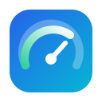
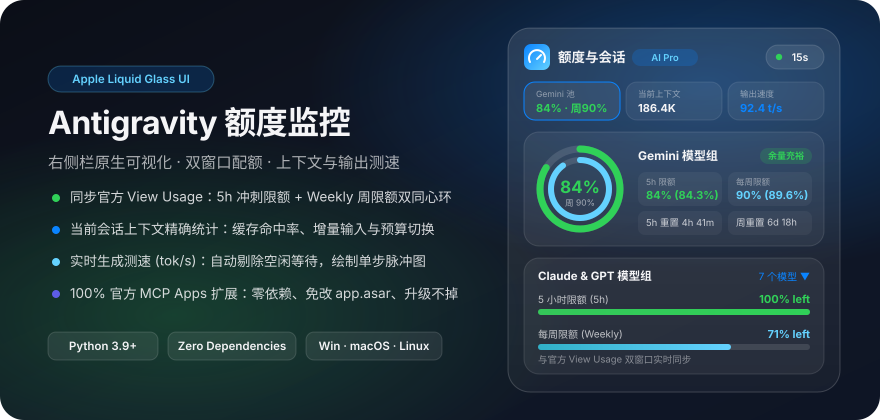

<div align="center">



# Antigravity Quota Monitor

**Apple 毛玻璃质感的 Google Antigravity 右侧栏额度、会话上下文与输出速度监控插件**

[](https://github.com/leaomiguel894-create/antigravity-quota-monitor/releases/latest)
[](https://github.com/modelcontextprotocol/ext-apps)
[](https://www.python.org/)
[](#🔒-隐私与安全声明)
[](LICENSE)

<br />



</div>

---

## 💡 为什么做这个插件？

在使用 Google Antigravity 进行高强度 Agent 编码时，查看剩余额度往往需要点进多层菜单，且缺乏**消耗配速判断**、**当前对话上下文占用透视**与**输出速度监控**。

市面上部分工具通过解包改写客户端底层 `app.asar` 注入按钮，每次客户端升级都会失效，还可能破坏 macOS / Windows 应用签名校验。

**`antigravity-quota-monitor`** 采用 Antigravity 官方原生 **MCP Apps (`aux_pane`)** 标准构建：
- **不改客户端一行文件**：独立安装在 `~/.gemini/config/plugins/quota-monitor`，客户端随意升级不掉插件、不破签名。
- **零第三方依赖**：后端仅使用 Python 标准库（无需 `pip install`、无需 Node.js），前端单文件自包含。
- **100% 同步官方双窗口配额**：直接对接宿主权威 `RetrieveUserQuotaSummary` 接口，同时呈现 **5 小时冲刺限额 (`5h`)** 与 **每周基线限额 (`Weekly`)**。

---

## ✨ 核心功能

| 模块 | 亮点说明 |
| :--- | :--- |
| **Apple Liquid Glass 美学** | 多层 `backdrop-filter` 毛玻璃、顶部 `1px` 高光内描边与极光弥散光晕，原生适配 Antigravity **浅色 / 深色主题**。 |
| **双同心圆环仪表盘** | Apple Watch Activity 风格：**外环展示 5h 限额 + 时间基准锚点**，**内环展示 Weekly 周限额**；自动聚焦当前对话正在使用的模型组，支持点击任意组切换。 |
| **100% 对齐 `View Usage`** | 每个模型组（`Gemini` / `Claude & GPT`）并列展示 `5h` 与 `Weekly` 双轨进度条、官方整数余量、括号内 `0.1%` 级精确值与跳秒重置倒计时。 |
| **当前会话上下文透视** | 读取官方 `transcript.jsonl` 精确计费字段，展示已用 Token / 剩余窗口、`自动 / 200K / 1M` 预算切换，并用三色堆叠条拆解 **缓存命中 / 增量输入 / 模型输出**，支持切换最近 8 个会话。 |
| **输出速度测算 (`tok/s`)** | 自动剔除用户阅读与打字空闲间隔，统计 **最新 / 平均 / 峰值 `tok/s`**，绘制最近 14 步推理速度脉冲柱状图与模型步骤明细。 |
| **额度消耗趋势与模型目录** | 本地持久化记录历史消耗曲线（面积折线图），支持一键展开查看全部可用模型实时余量与状态标签。 |

---

## 🤖 一键让 AI 帮你安装（最推荐）

直接点击代码块右上角复制，粘贴发给你的 **Antigravity 对话框**，无论本机是否安装 Git，AI 都会自动完成下载、环境配置与免重启热加载：

```text
请帮我安装项目 https://github.com/leaomiguel894-create/antigravity-quota-monitor

按以下步骤执行：
1. 检查本机 Python 3.9+ 环境（零第三方依赖，无需 pip install）。
2. 若本机有 Git 则克隆仓库到临时目录；若无 Git 则直接下载 https://github.com/leaomiguel894-create/antigravity-quota-monitor/archive/refs/heads/main.zip 并解压。
3. 读取仓库内的 AGENTS.md，运行 install.ps1（Windows）或 bash install.sh（macOS/Linux），脚本会自动部署插件到 ~/.gemini/config/plugins/quota-monitor 并热刷新 MCP 服务。
4. 不要关闭或重启客户端；安装验证完成后告诉我如何在右侧栏打开「额度监控」。
```

---

## 🛠️ 手动安装（支持无 Git 环境）

前置要求：本机已安装 **Python 3.9+**（无需安装任何第三方库）。

### Windows（PowerShell 一行在线安装，无需 Git）
打开 PowerShell，直接复制粘贴运行：

```powershell
$z="$env:TEMP\agy-qm.zip"; $d="$env:TEMP\agy-qm"; Invoke-WebRequest "https://github.com/leaomiguel894-create/antigravity-quota-monitor/archive/refs/heads/main.zip" -OutFile $z; if(Test-Path $d){Remove-Item -Recurse -Force $d}; Expand-Archive $z -DestinationPath $d; powershell -NoProfile -ExecutionPolicy Bypass -File "$d\antigravity-quota-monitor-main\install.ps1"
```

> 或者在 [Releases](https://github.com/leaomiguel894-create/antigravity-quota-monitor/releases/latest) 下载 `antigravity-quota-monitor-v2.2.0.zip`，解压后双击运行里面的 **`install.bat`** 即可。

### macOS / Linux（终端一行在线安装，无需 Git）
打开终端，直接复制粘贴运行：

```bash
tmp="$(mktemp -d)" && curl -fsSL "https://github.com/leaomiguel894-create/antigravity-quota-monitor/archive/refs/heads/main.zip" -o "$tmp/qm.zip" && unzip -q "$tmp/qm.zip" -d "$tmp" && bash "$tmp/antigravity-quota-monitor-main/install.sh" && rm -rf "$tmp"
```

### 使用 Git 克隆安装
```bash
git clone https://github.com/leaomiguel894-create/antigravity-quota-monitor.git
cd antigravity-quota-monitor
# Windows (PowerShell): .\install.ps1
# macOS / Linux:        bash install.sh
```

---

## 📖 如何固定在右侧侧边栏

安装完成后，无需重启客户端，支持三种打开方式：

1. **常驻右侧侧边栏（推荐）**：点击 Antigravity 右上角 **Overview ➔ 插件 ➔ 额度监控**（或右侧辅助面板顶部的 **`+` ➔ 额度监控**），即可作为独立标签页常驻右侧栏。
2. **左侧导航全屏看板**：点击左侧主导航栏中的 **「额度监控」**。
3. **对话内随时唤起**：在聊天框直接输入 `打开额度监控` 或 `看看还剩多少额度`。

---

## 📁 目录结构

```text
antigravity-quota-monitor/
├── plugin.json                # Antigravity 插件清单
├── mcp_config.json            # MCP 服务端启动配置
├── AGENTS.md                  # AI 智能体自动安装指引
├── install.bat / install.ps1  # Windows 一键安装与热加载脚本
├── install.sh                 # macOS / Linux 一键安装与热加载脚本
├── assets/
│   ├── logo.svg               # 插件矢量图标
│   └── preview.svg            # 界面预览横幅
├── skills/
│   └── quota-monitor/SKILL.md # 对话意图触发技能
└── server/
    ├── mcp_server.py          # 零依赖 Python MCP 服务端（双窗口配额 + 上下文 + 测速）
    └── ui/
        ├── app.html           # Apple Liquid Glass 单文件前端模板
        └── ext-apps.bundle.js # 官方 @modelcontextprotocol/ext-apps SDK
```

---

## 🔒 隐私与安全声明

- **纯本地只读运行**：插件仅在本地回环地址（`127.0.0.1`）与你本机的 Antigravity Language Server 通信及读取本机日志，**不向任何外部服务器发起网络请求、不收集任何遥测或账号信息**。
- **零侵入宿主**：不修改 `Antigravity` 安装目录下的任何二进制或归档文件，卸载只需删除 `~/.gemini/config/plugins/quota-monitor` 文件夹即可。

## 📄 License

[MIT License](LICENSE)
